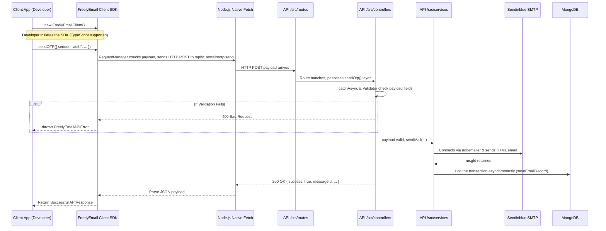

# FreelyEmail-API by Harshit (Harshit107) 🚀

A centralized, scalable, and modular REST API designed by **Harshit Keshari** ([@Harshit107](https://github.com/Harshit107)) to automatically dispatch customized emails, notifications, and verification links across different applications.

### 🌐 FreelyEmail Ecosystem
- [**FreelyEmail-API**](https://github.com/Harshit107/FreelyEmail-API) (:5000) — Core Email Engine
- [**FreelyEmail-Node-library**](https://github.com/Harshit107/FreelyEmail-Node-library) — Zero-Dependency Client SDK
- [**central-logging-service**](https://github.com/Harshit107/central-logging-service) (:5001) — TypeScript Central Audit Logger
- [**logging-dashboard**](https://github.com/Harshit107/logging-dashboard) (:5174) — Real-Time Trace & Telemetry Dashboard
- [**FreelyEmail-Showcase**](https://github.com/Harshit107/FreelyEmail-Showcase) (:5173) — Interactive Ecosystem Portal

## ✨ Architecture Flow Diagram



## 🚀 Key Features

- **Decoupled Architecture**: Follows best practices with `Controller`, `Service`, and `Routes` layers. Engineered for scale.
- **Rich HTML Templates**: Includes out-of-the-box, modern, and responsive HTML email templates for OTPs and Links.
- **Dynamic Content Support**: Inject dynamic parameters (e.g., OTP codes, App Name, time validity).
- **Centralized Error Handling**: Structured error responses and APIError classes.
- **Robust Validations**: Enforced standard API payload validation before processing.
- **Multiple Email Types**: Support for plain text, internal templates, and user-provided HTML templates.
- **MongoDB Logging**: Automatically tracks and stores all dispatched email metadata for robust auditing.

## 📁 Directory Structure

```text
📦 FreelyEmail-API
 ┣ 📂 src
 ┃ ┣ 📂 config         # Database and configuration files
 ┃ ┣ 📂 constants      # Centralized routes, error codes, and configuration defaults
 ┃ ┣ 📂 controllers    # Request/Response handlers
 ┃ ┣ 📂 middlewares    # Express middlewares (e.g. global error handler)
 ┃ ┣ 📂 models         # Mongoose database schemas
 ┃ ┣ 📂 routes         # API endpoint definitions
 ┃ ┣ 📂 services       # Business logic (e.g. nodemailer implementation)
 ┃ ┣ 📂 templates      # Modern HTML email templates
 ┃ ┗ 📂 utils          # Helper utilities (validations, catchAsync)
 ┣ 📜 app.js           # API entry point
 ┣ 📜 .env             # Environment Variables
 ┗ 📜 package.json     # Project Metadata & dependencies
```

## 🛠 Prerequisites

Make sure you have the following installed:
- [Node.js](https://nodejs.org/en/) >= 14.x
- [MongoDB](https://www.mongodb.com/) (Local or Atlas)
- An SMTP provider account: [Brevo](https://www.brevo.com/) (recommended) or any standard SMTP service

## ⚙️ Environment Variables

Create a `.env` file in the root folder and configure the following parameters:

```bash
PORT=5000
MONGO_URL_PROD=mongodb+srv://<username>:<password>@cluster.mongodb.net/freelyemail?retryWrites=true&w=majority

# Brevo Configuration (Supports REST API Key OR SMTP Relay)
BREVO_API_KEY=xkeysib-your-brevo-api-key
# OR SMTP Relay:
SMTP_HOST=smtp-relay.brevo.com
SMTP_PORT=587
BREVO_EMAIL=your-brevo-smtp-user@smtp-brevo.com
BREVO_PASSWORD=your-brevo-smtp-key

# Centralized From Email (Default Fallback)
DEFAULT_FROM_DOMAIN=mail.harshit107.online
DEFAULT_FROM_EMAIL=noreply@mail.harshit107.online
```

## 📬 Postman Collection

A ready-to-import Postman Collection is included directly in the root directory:
- File: [`FreelyEmail.postman_collection.json`](FreelyEmail.postman_collection.json)
- Includes pre-configured requests for all endpoints with `{{baseUrl}}` variable set to `http://localhost:5000`.

## 💻 Installation & Running

1. **Clone the repository:**
   ```bash
   git clone <repository_url>
   cd FreelyEmail-API
   ```

2. **Install dependencies:**
   ```bash
   npm install
   ```

3. **Start the server for Development:**
   ```bash
   npm run dev
   ```

4. **Start the server for Production:**
   ```bash
   npm start
   ```

## 🔌 API Endpoints

**Base URL**: `/api/v1/emails`

> **Note on Parameter Flexibility**: All endpoints accept both standard aliases for seamless integration:
> - `to` or `recipient`
> - `appName` or `app`
> - `text` or `message`
> - `html` or `HTMLfile`
> - `buttonText` (for link verification)
> - `sender` is optional and defaults cleanly to `"FreelyEmail"`

### 1. General Notification Email
Send an email with automatic modern HTML wrapping or your own custom HTML.
- **Endpoint:** `POST /send`
- **Body:**
  ```json
  {
    "to": "user@example.com",
    "appName": "My App",
    "subject": "Welcome to our app!",
    "message": "Thank you for joining us.",
    "ctaText": "Get Started",
    "ctaUrl": "https://myapp.com/dashboard"
  }
  ```

### 2. Send OTP with Template
Send an OTP to a user. You can generate your own OTP and pass it in the request.
- **Endpoint:** `POST /otp/send`
- **Body:**
  ```json
  {
    "to": "user@example.com",
    "appName": "My App",
    "subject": "Your Verification Code",
    "otp": "123456",
    "withValidTime": 10
  }
  ```

### 3. Request Auto-Generated OTP 
Let the API generate a cryptographically secure 6-digit OTP and send it via email automatically. Returns the OTP in the response body.
- **Endpoint:** `POST /otp/request`
- **Body:**
  ```json
  {
    "to": "user@example.com",
    "appName": "My App",
    "subject": "Your Verification Code",
    "withValidTime": 10
  }
  ```

### 4. Send Verification Link
Send an email with a high-converting CTA button for the user to click and verify their account.
- **Endpoint:** `POST /verification/link`
- **Body:**
  ```json
  {
    "to": "user@example.com",
    "appName": "My App",
    "subject": "Verify Your Email Address",
    "link": "https://myapp.com/verify?token=abcxyz",
    "buttonText": "Confirm Account",
    "withValidTime": 30
  }
  ```

### 5. Health Check
Check whether the service is running.
- **Endpoint:** `GET /api/v1/health`
- **Response:**
  ```json
  {
    "success": true,
    "data": {
      "status": "healthy",
      "uptime": 14.2,
      "timestamp": "2026-10-10T14:30:00.000Z"
    },
    "message": "Server is working perfectly fine.",
    "error": null
  }
  ```

---

## 🏛️ Centralized Constants & Configuration

All route paths, network configuration defaults, success messages, error codes, and messages are defined in [`src/constants/index.js`](src/constants/index.js). This avoids hardcoded magic strings and keeps routing, validation, and responses uniform across the system.

- **`ROUTES`**:
  - `ROUTES.API_BASE`: `/api/v1`
  - `ROUTES.HEALTH`: `/api/v1/health`
  - `ROUTES.LEGACY_CHECK_SERVER`: `/checkServer`
  - `ROUTES.EMAILS.BASE`: `/api/v1/emails`
  - `ROUTES.EMAILS.SEND`: `/send`
  - `ROUTES.EMAILS.OTP_SEND`: `/otp/send`
  - `ROUTES.EMAILS.OTP_REQUEST`: `/otp/request`
  - `ROUTES.EMAILS.LINK_VERIFICATION`: `/verification/link`
- **`DEFAULT_CONFIG`**:
  - `PORT`: `3000`
  - `SMTP_HOST`: `smtp-relay.brevo.com`
  - `SMTP_PORT`: `587`
  - `DEFAULT_FROM_DOMAIN`: `mail.harshit107.online`
  - `DEFAULT_FROM_EMAIL`: `noreply@mail.harshit107.online`
- **`SUCCESS_MESSAGES`**:
  - `HEALTH`: `"Server is working perfectly fine."`
  - `EMAIL_SENT`: `"Email dispatched successfully"`
  - `OTP_SENT`: `"OTP email dispatched successfully"`
  - `OTP_REQUESTED`: `"OTP generated and dispatched successfully"`
  - `LINK_SENT`: `"Verification link email dispatched successfully"`

---

## ✨ Standardized Success Response Format

All successful responses across all endpoints follow an identical envelope:

```json
{
  "success": true,
  "data": {
    "messageId": "msg_abc123"
  },
  "message": "Email dispatched successfully",
  "error": null
}
```

---

## 🛡️ Standardized Error Response Format

All error responses (validation failures, 404 routes, bad JSON, and server crashes) strictly adhere to a unified JSON contract:


```json
{
  "success": false,
  "data": null,
  "error": {
    "errorCode": "CODE",
    "message": "Human-readable description of what went wrong",
    "details": null
  }
}
```

### Centralized Error Codes Catalog

| Error Code | HTTP Status | Description |
| :--- | :---: | :--- |
| `INVALID_JSON` | 400 | Malformed JSON in HTTP request body |
| `VALIDATION_ERROR` | 400 | Payload validation failed (e.g. missing required fields or bad emails) |
| `MISSING_REQUIRED_FIELDS`| 400 | Required parameters (sender, recipient, app, subject) are absent |
| `INVALID_RECIPIENT` | 400 | Recipient email is not in valid email format |
| `MISSING_EMAIL_CONTENT` | 400 | Both `message` and `HTMLfile` are missing |
| `INVALID_OTP` | 400 | The `otp` field is empty or missing |
| `INVALID_LINK` | 400 | The verification `link` is empty or missing |
| `ROUTE_NOT_FOUND` | 404 | The requested endpoint does not exist |
| `RATE_LIMIT_EXCEEDED` | 429 | Upstream / gateway rate limit exceeded |
| `SMTP_NOT_CONFIGURED` | 500 | Missing `BREVO_EMAIL` or `BREVO_PASSWORD` |
| `EMAIL_SEND_FAILED` | 500 | SMTP transporter failed to deliver the email message |

| `INTERNAL_SERVER_ERROR` | 500 | Generic unhandled server error |

---

## 🤝 Contributing
Issues and Pull Requests are welcome to make this API even more robust.

